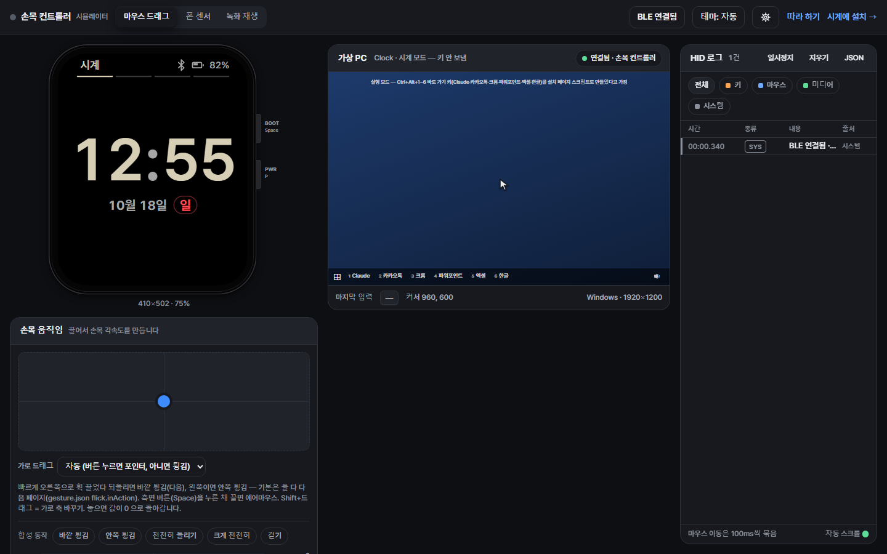

# 손목 컨트롤러

**Waveshare ESP32-C6 2.06인치 AMOLED 시계를 PC용 블루투스 키보드·마우스로 만들어, 손목에서 발표 슬라이드·앱 실행·화상 회의를 조작한다.** PC에는 따로 설치할 프로그램이 없다.



- 웹앱(시뮬레이터 · 시계에 설치 · 따라 하기): https://ibrkiller-penz.github.io/watchpeter/
- 따라 하기 안내서(교사·학생용, 휴대폰으로 읽기 좋게): [`sim/guide.html`](sim/guide.html) — 웹앱의 '따라 하기'
- 하드웨어: Waveshare **ESP32-C6**-Touch-AMOLED-2.06(배터리 포함판 권장). 이름이 비슷한 **S3 판과는 다른 보드**라 이 펌웨어가 맞지 않는다
- 대상: Windows(1순위)·macOS(2순위) / PowerPoint, Google Slides, Zoom, Teams, Google Meet
- 라이선스: [MIT](LICENSE) · 서드파티 고지: [THIRD_PARTY.md](THIRD_PARTY.md) · 개발 기록: [docs/HISTORY.md](docs/HISTORY.md)

## 빠른 시작

### 사용자(시계를 산 교사·학생)

웹앱의 **따라 하기** 안내서를 그대로 따라 한다. 요약:

1. **원래 펌웨어 백업**(꼭 먼저) — `pip install esptool` 후 `esptool --chip esp32c6 -p COM7 -b 460800 read-flash 0 ALL original_backup.bin`
2. **설치** — Chrome·Edge 로 웹앱의 '시계에 설치' 페이지(ESP Web Tools). 처음 설치는 '지우기(Erase)' 선택, 업데이트는 지우지 않기(페어링 유지)
3. **페어링** — Windows 설정 → 블루투스 및 장치 → 장치 추가 → `손목 컨트롤러 XXXX`
4. **시계 시간 맞추기** — 설치 페이지의 '시계 시간 맞추기' 버튼(USB 연결)
5. **PC 바로 가기 키** — 설치 페이지에서 `wrist-shortcuts.ps1` 을 받아 실행(실행 모드의 Ctrl+Alt+1~6)

### 개발자

```bash
cd sim && npm install && npm run dev   # 시뮬레이터 http://localhost:5173 — 키·판정값을 먼저 여기서 시험
npm test                               # 공유 테스트 벡터 포함
python tools/gen_keymap_header.py      # shared/keymap.json·gesture.json → 펌웨어 헤더
```

키 배치는 `shared/keymap.json`, 판정값은 `shared/gesture.json` 만 고친다. push 하면 GitHub Actions 가 테스트하고 펌웨어를 빌드한다(ESP-IDF 를 PC 에 설치하지 않아도 된다). 아래 '실행법'·'펌웨어 빌드' 참고.

## 기능

1. 슬라이드 넘기기: 화면 탭(오른쪽 = 다음, 왼쪽 = 이전). 손목 튕김은 **기본 꺼짐**(시계 설정에서 켜면 발표 모드에서 다음)
2. 화면 암전: 발표 화면 가운데 0.36초 누름 → 마침표 `.`(한글 입력 상태에서도 동작)
3. 네 모드: 시계(키 안 보냄) / 발표 / 실행(Ctrl+Alt+1~6 앱 실행, 2쪽 캡처·잠금 등) / 회의(마이크·카메라·손 들기)
4. 에어마우스: BOOT 를 누른 채 손목을 움직이면 포인터 이동(기본 꺼짐, 시계 설정에서 켬)
5. 음성 명령은 넣지 않았다(ESP32-C6 메모리 부족, PSRAM 없음). 나중 계획: [docs/research/gemini-later.md](docs/research/gemini-later.md)

## 저장소 구조

기준 문서(처음 요구 사항): [`손목컨트롤러_작업지시서.md`](손목컨트롤러_작업지시서.md). 진행 방식: 시뮬레이션 → 검증 → 빌드 → 배포.

```
/shared            설정 원본(시뮬레이션과 펌웨어가 함께 쓴다)
  keymap.json        3모드 × 앱 × Windows/macOS 단축키, 장치 이름
  gesture.json       튕김·에어마우스·터치·버튼 판정값
  hid-usage.json     키 이름 → HID 사용 코드
  schema/            JSON 스키마(keymap, gesture, test-vector)
  test-vectors/      입력 → 기대 출력 묶음. TS 와 C++ 가 같은 벡터를 통과해야 한다
/sim               시뮬레이션 사이트(Vite + TypeScript) — 구조는 sim/ARCHITECTURE.md
  src/core/          판정 로직(TS) — 모드 상태 기계, 키맵, 튕김, 에어마우스
/firmware          시계 펌웨어(ESP-IDF 5.5 + NimBLE + LVGL 9)
  logic/             판정 로직(C++17, 하드웨어 의존 없음) — sim/src/core 와 1:1 대응
  test/              호스트 테스트(CMake) — /shared/test-vectors 를 C++ 로직에 돌린다
  main/              ESP-IDF 진입점(골격, 단계별 TODO), 핀 표, BLE HID 리포트 맵 초안
  main/generated/    keymap_gen.h — tools/gen_keymap_header.py 가 만든다(손으로 고치지 않음)
/tools             keymap.json → C 헤더 생성기, 웹 설치용 매니페스트·버전 목록 생성기
/design            화면 디자인(토큰, 목업, 화면 명세)
/docs/research     하드웨어·펌웨어 스택·단축키·웹 알고리즘 조사(출처 포함)
/.github/workflows CI(테스트 → 빌드 → 태그 시 펌웨어 Release)
```

로직 대응표(같은 테스트 벡터로 대조):

| 역할 | 시뮬레이션(TS) | 펌웨어(C++) |
| --- | --- | --- |
| 공용 타입 | `sim/src/core/types.ts` | `firmware/logic/include/wc/types.h` |
| 모드 상태 기계 | `modeMachine.ts` | `mode_machine.cpp` |
| 키맵 해석·표기 | `keymap.ts` | `keymap.cpp` |
| 화면 영역 | `layout.ts` | `layout.cpp` |
| 영점 추적·축 | `imu.ts` | `imu.cpp` |
| 에어마우스 | `airmouse.ts` | `airmouse.cpp` |
| 손목 튕김 | `gesture.ts` | `gesture.cpp` |
| 벡터 실행기 | `vectors.ts` | `firmware/test/test_vectors.cpp` |

## 실행법

### 시뮬레이션 사이트

```bash
cd sim
npm install          # 처음 한 번(Node 24)
npm run dev          # http://localhost:5173
npm test             # 공유 테스트 벡터 포함
npm run build        # dist/index.html(시뮬레이터), dist/install.html(시계에 설치), dist/guide.html(따라 하기)
```

폰의 기울기 센서는 HTTPS 에서만 동작한다(배포된 사이트에서 확인).

### 웹앱(설치형, PWA)

- 배포본: https://ibrkiller-penz.github.io/watchpeter/ (빌드 파일만 올린 공개 저장소). Firebase Hosting 설정도 `sim/firebase.json` 에 있다(`npm run deploy`).
- 설치 방법
  - PC(크롬·엣지): 주소창 오른쪽의 **앱 설치** 아이콘(또는 메뉴 → 앱 → 이 사이트를 앱으로 설치)
  - 안드로이드 크롬: 메뉴(⋮) → **홈 화면에 추가**(또는 앱 설치)
  - 아이폰 사파리: 공유 버튼 → **홈 화면에 추가**
- 한 번 열면 서비스워커가 화면 파일을 받아 두어 인터넷 없이도 열린다. 따라 하기 안내서도 함께 캐시된다. ESP Web Tools(시계 설치)는 여전히 인터넷이 필요하다.
- 새 버전을 배포하면 화면 아래에 "새 버전이 있습니다 [새로고침]" 안내가 뜬다.

### 키 배치 바꾸기

키는 코드에 쓰지 않는다. `shared/keymap.json` 만 고친다.

```bash
# 1) shared/keymap.json 수정(또는 시뮬레이터 설정 화면에서 편집 → JSON 내보내기)
# 2) 펌웨어 헤더 다시 만들기
python tools/gen_keymap_header.py
# 3) 최신인지 확인(CI 도 같은 검사를 한다)
python tools/gen_keymap_header.py --check
```

### 펌웨어 로직 테스트(PC)

C++ 컴파일러와 CMake 3.16 이상이 필요하다. nlohmann/json 은 CMake 가 받아 온다.

```bash
cmake -S firmware/test -B build/fwtest
cmake --build build/fwtest
ctest --test-dir build/fwtest --output-on-failure
```

같은 벡터를 두 설정으로 돌린다: `[json]` = shared/*.json 직접, `[gen]` = 생성 헤더(시계가 실제로 쓰는 값). 생성 헤더가 JSON 과 다르면 실패한다.

### 펌웨어 빌드(2단계)

PC 에 ESP-IDF 가 없어도 GitHub Actions 로 빌드할 수 있다(IDF v5.5.5, target esp32c6). 포크한 저장소에서도 같다.

```bash
gh workflow run ci.yml --ref main                 # 수동 실행 = 개발판 .bin 빌드
gh run list --event workflow_dispatch --limit 1   # run ID 확인
gh run watch <id>                                 # 끝나면 아티팩트 firmware-v0.0.0-dev.<커밋>
```

IDF 가 있는 PC 에서는 `cd firmware && idf.py set-target esp32c6 && idf.py build`.
첫 빌드 때 컴포넌트 매니저가 `main/idf_component.yml` 의존성(BSP `waveshare/esp32_c6_touch_amoled_2_06` 2.0.0, `lvgl/lvgl` 9.5.0,
`espressif/esp_lcd_touch` 1.x — 그 밖에 BSP 가 `esp_lvgl_port` 2.9.0·`esp_lcd_sh8601` 2.0.0·`esp_lcd_touch_ft5x06` 1.1.1 등을 끌어온다)을 내려받는다.

| 파일 | 내용 |
| --- | --- |
| `main/main.cpp` | 하드웨어 ↔ 코어(`wc::step`) 배선: 버튼·터치·IMU 태스크, HID 전송, 설정 화면 동작, 전원 관리, 직렬 명령, 메모리 로그 |
| `main/ui.cpp` | 세 모드 화면·상태줄·시트·연결 대기·끊김 배너·설정 화면(STEP5). 그리기만 하고 터치 판정은 하지 않는다 |
| `main/display_ui.c` | 패널·LVGL(STEP2, 회전 버퍼 끔·40줄 이중 DMA 버퍼), 터치 원시 읽기(STEP5), 밝기·패널 끄기(STEP9) |
| `main/ble_hid.c` | BLE HID(STEP3·4). NimBLE + esp_hidd 복합 맵, Just Works 본딩, 연결될 때까지 광고·끊기면 재광고 |
| `main/imu_qmi8658.c` | IMU(STEP6). 주소 자동 탐지·WHO_AM_I 확인 |
| `main/pmu_axp2101.c` | 배터리(STEP9). 읽기 전용 |
| `logic/src/touch_gesture.cpp` | 터치 제스처 판정(시뮬레이터 watch.ts 와 같은 규칙). 호스트 테스트 `test/test_touch.cpp` |
| `sdkconfig.defaults` | NimBLE HID 서비스·본드 NVS, BSP 버퍼 40줄, LVGL 글꼴, BLE 배터리 서비스 |
| `partitions.csv` | nvs 0x9000 · factory 0x10000 · storage 0x410000 (2026-10-17 음성 모델 파티션 뺌) |


### 시계 안 조작(펌웨어)

> **손목 튕김은 기본 꺼짐**(gesture.json `flick.enabled` false, 2026-10-18 사용자 결정) — 시계 설정 '손목 튕김' 줄로 켠다(NVS). 꺼져 있으면 판정 자체를 하지 않고, IMU 는 손목 들기·녹화용으로만 읽는다. 켜도 **발표 모드에서만 동작한다.** 시계·실행·회의 모드에서는 손목을 튕겨도 아무것도 보내지 않는다. 잠금 중(BOOT 2초)에도 무시한다.


- 측면 버튼(실물 오른쪽 면): **위 = BOOT, 아래 = PWR**. BOOT 짧게 = 시계 모드로(모든 모드, 키 안 보냄), 이미 시계면 직전 모드로. BOOT 누른 채 = 에어마우스(발표 모드), BOOT 2초 = 제스처 잠금. PWR 짧게 = 화면 켜기/끄기만.
- 가로 스와이프 = 모드 전환(시계 → 발표 → 실행 → 회의, 기본 시작 = 시계, 마지막 모드는 NVS 에 남는다). 시계 모드는 키를 보내지 않는다.
- 발표: 오른쪽 탭 = 다음, 왼쪽 탭 = 이전(손 뗄 때 전송), 가운데 길게(0.36초 — 다른 길게 누르기는 0.6초) = 암전(마침표 `.` — B 는 한글 입력 상태에서 'ㅠ' 로 먹혀 2026-10-18 에 바꿈), 위에서 아래로 당김 = 쇼 시작/종료 시트. 다음 슬라이드 = 오른쪽 탭(손목 튕김은 설정에서 켰을 때만. BOOT 짧게는 '다음'이 아니다). **손목 튕김은 다음 페이지만** — 방향과 상관없이 다음(→). 판정은 **가속도 기준**(gesture.json `flick.detector` accel 기본: 중력 제거 가속도 hp = |a − LPF(a)| 가 `flick.accel.peakG` 1.0g 이상으로 250ms 이하 튀면 인식, 직전 300ms 가 시끄러우면(걷기·흔들기) 기각, 0.8초 재인식 금지). 옛 각속도 방식은 `detector: gyro`(이때 안쪽 튕김은 `flick.inAction` next/none/prev). **에어마우스는 기본 끔**(gesture.json `airMouse.enabled` false) — 시계 설정 '에어마우스'에서 켜면(NVS) 발표 모드에서 BOOT 를 누른 채 움직여 포인터, 끄면 감도 줄이 흐려진다.
- 실행(launcher.md): 1쪽 Claude·카카오톡·크롬·파워포인트·엑셀·한글 = **Ctrl+Alt+1~6**(PC 시작 메뉴 바로 가기 키 — 설치 페이지 'PC 바로 가기 키 설정'의 `wrist-shortcuts.ps1` 로 만든다. 작업표시줄 순서·한/영과 무관), 길게 = Win+R 대안(크롬·파워포인트·엑셀만). 2쪽(위로 쓸기 또는 아래 쪽 점 탭) = 캡처 Win+Shift+S·잠금 Win+L·바탕화면 Win+D·화면 전환 Win+P·음소거(미디어 키)·업무포털(주소는 시뮬레이터 설정 화면에서 keymap url 로 — 비어 있으면 비활성). macOS 는 Spotlight(Cmd+Space → 영문 이름 → Return).
- 발표 외 모드에서 위에서 아래로 당김(또는 쇼 시트의 설정 행) = 시계 설정 화면(감도, OS, 손목 들면 시계, IMU 녹화, 이름, 버전, 닫기). 줄 탭 = 바꾸기. 닫기 = 맨 아래 '닫기' 탭 · 위로 쓸기(위로 40px 이상, 위로 > 1.2 × 가로 — 움직이는 도중에도 바로 닫힘) · 오른쪽 스와이프 · BOOT 짧게(닫고 시계 모드로) · PWR 짧게(닫기만) · 30초 무입력.
- USB 직렬(USB-Serial/JTAG 콘솔): `r` IMU 녹화 시작/정지, `s` 상태, `n <이름>` 장치 이름(다시 켜면 적용), `t <유닉스초> <시간대분>` 시각 맞추기(RTC 기록, 설치 페이지 '시계 시간 맞추기' 버튼이 보낸다), `h` 도움말.
- BLE 장치 이름 기본값 = '손목 컨트롤러 XXXX'(BT MAC 끝 4자리, 두 대 구분). 배터리 서비스(BAS)로 잔량 %를 PC 에 알린다(Windows 블루투스 화면).
- 화면 글꼴은 Pretendard 한글 서브셋(UI v2 P0, `shared/strings.ko.json`). 한글 장치 이름도 그대로 보인다.
- **펌웨어 쓰기는 세 파일을 나눠 쓴다(NVS·페어링 보존, 2026-10-18 정정)**: CI 아티팩트의 `…-bootloader.bin`(0x0)·`…-partition-table.bin`(0x8000)·`…-app.bin`(0x10000)과 `flash_args`, 명령 예시는 `FLASH.txt`.
  `esptool --chip esp32c6 -p COM7 -b 460800 write-flash 0x0 …-bootloader.bin 0x8000 …-partition-table.bin 0x10000 …-app.bin`
  예전 안내('합친 이미지를 0x0 에 통째로, NVS 는 남는다')는 **틀렸다**: merge-bin 이 0x8C00~0x10000 빈칸을 0xFF 로 채워 NVS(0x9000~0xF000)·phy_init 을 덮어쓴다 → 쓸 때마다 본드가 지워져 Windows 의 옛 키로 암호화가 실패했다(로그: docs/bootlog_2026-10-18_bond-mismatch.txt). `…-merged-full-erase.bin` 은 처음 설치·완전 초기화(옛 파티션 배치 dev.75008c8 이전에서 넘어올 때 포함)용으로만 쓴다. 웹 설치 매니페스트도 같은 세 파일이다.
- 본드 불일치(암호화 실패) 때 시계는 그 PC 본드를 지우고 상태줄 BLE 를 노랑으로, 대기 화면·배너에 'PC에서 이 장치를 제거하고 다시 추가하세요' 를 띄운다. 광고 시작이 실패하면 500ms 마다 다시 시도한다(광고가 멈추지 않음).

첫 업로드 전에는 반드시 아래 '원래 펌웨어 백업'을 먼저 한다.

### tools 테스트

```bash
python -m unittest discover -s tools -p "test_*.py" -v
```

### 손목 튕김 녹화·튜닝

1. 시계를 USB 로 연결하고 직렬 터미널(115200)에서 `r` Enter → IMU 녹화 시작(로그는 경고 이상만), 손목을 튕긴 뒤 다시 `r` Enter → `# end`.
2. 직렬 로그를 저장한다. 숫자로 시작하는 줄이 `t_ms,gx,gy,gz,ax,ay,az` CSV(10ms 간격, deg/s·g), 나머지는 로그.
3. 시계 직렬 로그(녹화 중이 아닐 때)에 `튕김 인식 hp 피크 2.91g`·`튕김 기각 tooLong hp 피크 …` 가 남는다. 이 값으로 `flick.accel.peakG`(기본 1.0g, 2026-10-18 사용자 결정으로 0.8→1.0)를 조정한다(2026-10-18 1호기 녹화: 세게 2.8~4.6g, 약하게 1.35~1.84g, 가만히 0.01g, 천천히 0.04g, 튕김 사이 0.07g).
4. CSV 줄만 뽑아 `sim/public/samples/` 에 두면 시뮬레이터 '녹화 재생' 목록에서 재생된다(`inputPanel.ts` 목록). 공유 테스트 벡터로 만들려면 `sim/scripts/gen-test-vectors.mjs` 의 imu-real 절처럼 기대값(다음 n회)을 적고 `node sim/scripts/gen-test-vectors.mjs`.

녹화 결과·튜닝 기록은 [docs/HISTORY.md](docs/HISTORY.md). 완료 기준은 작업지시서 '검증 체크리스트'.

## 빌드·배포 파이프라인

`.github/workflows/ci.yml`

1. push / PR: `sim`(npm ci → test → build), `tools`(헤더 `--check` + 단위 테스트), `firmware-logic`(CMake 호스트 테스트). 하나라도 실패하면 멈춘다.
2. 태그 `vX.Y.Z` push: ESP-IDF 빌드(`espressif/esp-idf-ci-action`, IDF v5.5.5) → `esptool merge-bin` 으로 이미지 하나 → ESP Web Tools 매니페스트.
3. GitHub Release 에 `.bin`·`.elf`·`manifest.json`·`SHA256SUMS` 첨부(보관용).
4. 사이트 묶음: `sim/dist` + 모든 Release 의 펌웨어 사본(`firmware/vX.Y.Z/`) + `firmware/versions.json`.
   GitHub Release 주소는 CORS 헤더가 없어 브라우저 설치기가 직접 받지 못하므로 같은 출처에 사본을 둔다(docs/research/firmware-stack.md 6.3).
5. Cloudflare Pages 배포: 기본 비활성. 켜는 방법은 ci.yml 맨 아래 주석.

설치 페이지는 `firmware/versions.json` 을 읽어 버전을 고르게 한다(형식은 `tools/firmware_site.py` 머리말).

## 원래 펌웨어 백업·복원

근거: docs/research/firmware-stack.md 5장(esptool v5 기준, 하이픈 명령), docs/research/hardware.md 2.1.
`COM7` 은 예시 포트다(USB-Serial/JTAG, 다운로드 모드 자동 진입). 장치 관리자에서 실제 포트를 확인한다.

**다운로드 모드**: BOOT 버튼을 누른 채 전원을 켠다. 작업이 끝나면 전원을 껐다 켠다.

```bash
# 0) 설치
pip install esptool

# 1) 칩·플래시 용량 확인 — 실물: ESP32-C6, 16MB
esptool --chip esp32c6 -p COM7 flash-id

# 2) (읽기 전용) 암호화·보안 부트 여부 확인 — 켜져 있으면 백업은 같은 칩에만 복원할 수 있다
espefuse --chip esp32c6 -p COM7 summary

# 3) 전체 백업 — 2026-10-16 실제로 한 명령(16MB, 약 90초). 결과: backup/original_xiaozhi_esp32c6_16MB.bin
esptool --chip esp32c6 -p COM7 read-flash 0 0x1000000 backup_full.bin

# 4) 무결성 기록 — 같은 명령으로 두 번 받아 해시가 같은지 비교하면 더 안전하다
certutil -hashfile backup_full.bin SHA256        # Windows
# sha256sum backup_full.bin                      # macOS/Linux

# 5) 복원(전체 이미지를 0x0 에 쓴다. v5 는 쓰고 나서 자동으로 검증한다)
esptool --chip esp32c6 -p COM7 write-flash 0x0 backup_full.bin
```

- 백업 파일은 저장소에 올리지 않는다(기기 고유 정보·페어링 키가 들어 있다).
- 보조 복원 수단: Waveshare 공식 저장소 Releases 의 공장 펌웨어 바이너리.
- 공장 펌웨어나 원래 펌웨어를 복원한 뒤 이 펌웨어를 다시 설치할 때는 설치 대화상자에서 **장치 지우기(Erase)를 선택**한다(파티션이 달라 설정 영역이 어긋날 수 있다).
- 이 펌웨어끼리 버전을 올릴 때는 지우지 않으면 페어링·설정(NVS)이 유지된다. 파티션 표(`firmware/partitions.csv`)는 v0.1.0 에서 확정하고 바꾸지 않는다.

## 하드웨어 메모

공식 자료로 확인한 핀·부품은 `firmware/main/board_pins.h`(근거: docs/research/hardware.md 3장). 확인 못 한 값은 `TODO(미확인)` 으로 두고 쓰지 않는다.

- 칩: ESP32-C6 (RISC-V 싱글코어 160MHz, **PSRAM 없음**, 내부 SRAM 512KB), 플래시 16MB. 화면 전체 버퍼(411KB)를 둘 수 없어 LVGL 부분 버퍼(40줄 이중, 부족하면 20줄)를 쓴다.
- 버튼: BOOT = GPIO9(누르면 LOW), PWR = GPIO18(누르면 HIGH). **PWR 는 PMU 전원키와 같아 길게(샤오즈 설정 4초) 누르면 전원이 꺼진다** — 2초 잠금은 그 전에 판정된다. 주 버튼은 BOOT(`keymap.json settings.primaryButton`).
- 오디오는 ES8311(재생) + ES7210(녹음) 구성. C6 는 ESP-SR 명령 인식·AFE 를 지원하지 않는다.
- **없는 것**: 진동 모터, SD 슬롯, USB OTG. 진동 피드백은 화면 표시로 대신한다.
- IMU INT1/INT2(GPIO16/17)가 UART0 와 겹치므로 로그 콘솔은 USB-Serial/JTAG 로 고정한다.
- 미확인: QMI8658 I2C 주소(0x6B / 0x6A) — 실물 I2C 스캔으로 확정.

## 라이선스

- 이 저장소의 코드·문서: [MIT](LICENSE)
- 글꼴(Pretendard, SIL OFL 1.1)·LVGL·ESP-IDF·Waveshare BSP 등 서드파티: [THIRD_PARTY.md](THIRD_PARTY.md)

## 출처

조사 문서(모든 사실에 원 출처 URL 이 달려 있다):

- [docs/research/hardware.md](docs/research/hardware.md) — 보드 부품·핀 배치(Waveshare 위키, 회로도 V1.0, 공식 예제 저장소)
- [docs/research/firmware-stack.md](docs/research/firmware-stack.md) — ESP-IDF·NimBLE 복합 HID, LVGL 9 드라이버, esptool 백업·복원, ESP Web Tools 매니페스트
- [docs/research/shortcuts.md](docs/research/shortcuts.md) — 앱별 단축키 공식 도움말 검증
- [docs/research/voice.md](docs/research/voice.md) — ESP-SR 지원 언어·메모리, 음성 방식 A/B/C 비교(기록용 — 음성은 2026-10-17 제거)
- [docs/research/gemini-later.md](docs/research/gemini-later.md) — 나중에 Gemini 음성을 넣을 때의 메모리 예산·구조
- [docs/research/web-and-algorithms.md](docs/research/web-and-algorithms.md) — 웹 센서 API, 에어마우스·튕김 알고리즘

주요 원 출처:

- Waveshare 공식 예제·회로도·공장 펌웨어(C6): https://github.com/waveshareteam/ESP32-C6-Touch-AMOLED-2.06
- 샤오즈 보드 정의: https://github.com/78/xiaozhi-esp32/tree/main/main/boards/waveshare/esp32-c6-touch-amoled-2.06
- (참고, 이전 가정) S3판 위키: https://www.waveshare.com/wiki/ESP32-S3-Touch-AMOLED-2.06
- ESP-IDF `esp_hid_device` 예제: https://github.com/espressif/esp-idf/tree/master/examples/bluetooth/esp_hid_device
- esptool 명령: https://docs.espressif.com/projects/esptool/en/latest/esp32c6/esptool/basic-commands.html
- ESP Web Tools: https://esphome.github.io/esp-web-tools/
- USB HID Usage Tables 1.5: https://usb.org/sites/default/files/hut1_5.pdf
- ESP-IDF 빌드 액션: https://github.com/espressif/esp-idf-ci-action
- nlohmann/json(호스트 테스트 전용): https://github.com/nlohmann/json
